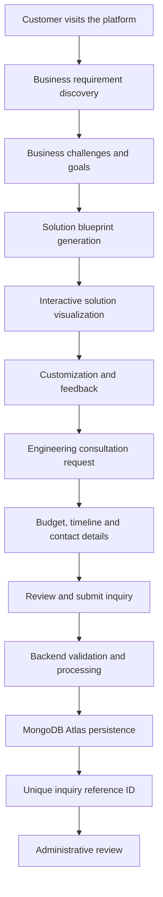
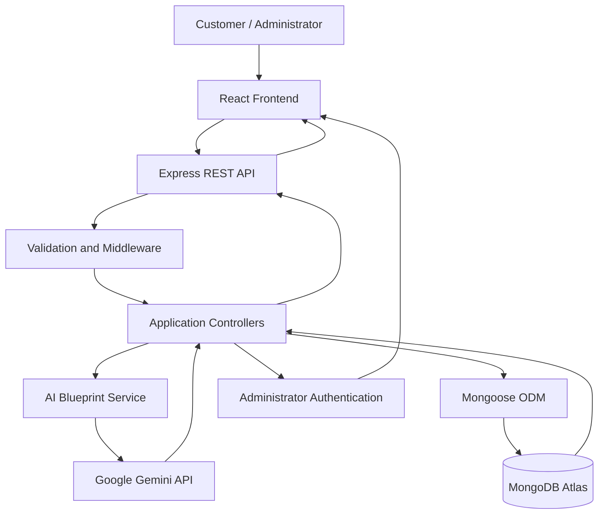

# Cynbit AI Solution Studio

**An intelligent platform for business requirement discovery, solution planning, and interactive software visualization.**

Cynbit AI Solution Studio helps businesses translate operational challenges into structured software requirements and explore potential digital solutions through an interactive discovery experience.

It brings business requirement collection, solution blueprint generation, visual concept exploration, customization, consultation requests, and project inquiry management together in one platform.

## Project Links

| Resource | Link |
|---|---|
| **GitHub Repository** | [View Source Code](https://github.com/Ayushi-Choudhary22/cynbit-smart-project-hub) |
| **Working Prototype** | [Explore Application](https://cynbit-smart-project-hub.vercel.app) |
| **Backend API** | [Backend Service](https://cynbit-smart-project-hub.onrender.com) |
| **Backend Health Check** | [API Diagnostics](https://cynbit-smart-project-hub.onrender.com/api/health) |
| **Company Website** | [Cynbit Technologies](https://www.cynbit.in/) |

---

## 1. Overview

Businesses often know what they want to improve but may not know how to translate those needs into clear software requirements.

For example, a healthcare organization might be struggling with patient queues, appointment coordination, and disconnected records. It may recognize these operational problems without knowing which software modules, workflows, or integrations would address them.

This creates a gap between identifying a business problem and defining a practical software solution.

**Cynbit AI Solution Studio addresses this gap through a guided digital discovery process.**

Customers can describe their business, identify challenges, explore a proposed solution blueprint, interact with a visual concept, customize requirements, and submit a structured project inquiry.

The platform also provides an administrative dashboard for reviewing and managing submitted inquiries.

## 2. Key Features

### Business Requirement Discovery

- Collects company and business information.
- Captures industry, target audience, business stage, and operational challenges.
- Identifies existing tools, systems, and workflow limitations.
- Records business goals and desired outcomes.
- Uses guided questions to organize project requirements.

### AI-Assisted Solution Blueprint

- Analyzes the submitted business context.
- Generates structured solution recommendations using Google Gemini.
- Identifies business problems and target user groups.
- Suggests functional modules and primary workflows.
- Provides technical architecture and technology recommendations.
- Identifies potential integrations and security considerations.
- Outlines implementation phases, assumptions, and clarification requirements.
- Supports conversational refinement of the proposed blueprint.

### Interactive Solution Visualizer

Transforms a proposed solution into an interactive, React-rendered concept.

Supported solution categories include:

- Healthcare and clinical platforms.
- Pet care and veterinary platforms.
- E-commerce applications.
- SaaS dashboards.
- AI agent automation interfaces.
- Property and tenant management platforms.
- Mobile application concepts.

Users can explore relevant interface elements, switch between desktop and mobile previews, and examine how proposed features could fit into a software product.

The visualizer represents an interactive concept prototype, not a complete production application for each industry.

### Solution Customization and Feedback

- Explore different visual presentation options.
- Modify supported features through interactive controls.
- View changes in the concept preview.
- Record customization preferences.
- Provide feedback and indicate concept approval.

### Engineering Consultation

- Request an engineering discussion.
- Select a preferred communication channel.
- Provide preferred date and time information.
- Record discussion topics.
- Track consultation request status.

Consultation requests remain subject to confirmation; submitting a request does not automatically confirm an appointment.

### Project Inquiry and Submission

- Capture project scope and requirements.
- Record budget preferences.
- Capture expected implementation timelines.
- Collect stakeholder contact information.
- Record consent.
- Generate a unique inquiry reference ID.
- Persist submitted project information in MongoDB Atlas.

### Administrative Inquiry Dashboard

A protected administrative interface provides:

- Administrator authentication.
- Inquiry listing and search.
- Lookup using inquiry reference IDs.
- Inquiry status filtering and management.
- Detailed business requirement inspection.
- Access to generated solution blueprints.
- Review of visual preferences and requested modifications.
- Consultation request tracking.
- Internal notes and inquiry management.

---

## 3. End-to-End Workflow

The platform connects the customer's initial business requirements to a structured project inquiry.



### Example: Healthcare Solution Discovery

Consider a healthcare organization that wants to improve its patient management process.

1. The organization describes its appointment and patient queue challenges.
2. The platform collects its business requirements and operational context.
3. A structured solution blueprint proposes relevant modules, such as appointment scheduling, patient records, and queue management.
4. The visualizer presents an interactive concept of the proposed platform.
5. The organization explores the concept and requests changes.
6. It submits its project preferences and consultation request.
7. The inquiry is stored and made available for administrative review.

This provides a more structured starting point for subsequent discussions between the customer and engineering team.

---

## 4. Technology Stack

The application uses a full-stack JavaScript architecture, with a separate frontend, backend API, database, and AI integration.

| Layer | Technology | Purpose |
|---|---|---|
| Frontend | React 18 | Component-based user interface |
| Build Tool | Vite | Frontend development and production builds |
| Styling | Tailwind CSS | Responsive interface styling |
| Backend | Node.js | Server-side JavaScript runtime |
| API Framework | Express.js | REST API and application routing |
| Database | MongoDB Atlas | Persistent application data storage |
| ODM | Mongoose | Database schemas and data operations |
| AI Integration | Google Gemini API | Business-context analysis and blueprint generation |
| Authentication | JSON Web Tokens | Administrator session authentication |
| Password Security | bcryptjs | Password hashing |
| Validation | Zod | Request data validation |
| Hosting | Vercel | Frontend deployment |
| Backend Hosting | Render | Backend API deployment |

### Why This Architecture?

The frontend and backend are separated to keep user interface responsibilities independent from business logic and data processing.

React provides reusable interface components, while Express handles API requests, validation, authentication, and communication with external services.

MongoDB Atlas stores submitted inquiry information, and the Gemini integration supports structured solution blueprint generation.

This architecture makes the application easier to maintain and extend as additional requirements are introduced.

---

## 5. System Architecture

The application follows a client-server architecture.



### Frontend Layer

The frontend provides the public-facing company website, guided discovery experience, solution visualizer, and administrative interface.

It communicates with the backend through API requests.

### Backend Layer

The Express backend handles:

- Discovery and blueprint generation requests.
- Inquiry validation and submission.
- Database operations.
- Administrator authentication.
- Inquiry retrieval and status management.

### AI Integration Layer

The AI service processes business context and generates structured solution recommendations.

A fallback mechanism is also included to handle situations where the primary AI service cannot provide a response, subject to the configured service behavior.

### Database Layer

MongoDB Atlas stores inquiry records and their associated project information.

Mongoose provides structured models and database interaction.

### Administrative Layer

Protected API routes allow authenticated administrators to inspect inquiries and manage their status.

---

## 6. Database and Data Management

The application uses MongoDB Atlas with Mongoose for persistent data storage.

The inquiry data structure supports information collected throughout the customer journey, including:

- Customer and company details.
- Business discovery responses.
- Project category and requirements.
- Generated solution blueprint.
- Visualizer configuration and customization preferences.
- Customer feedback.
- Consultation preferences and status.
- Budget and timeline information.
- Inquiry reference ID.
- Administrative status and internal notes.

This allows the administrative dashboard to present the complete context of a submitted project inquiry rather than only basic contact information.

### Database Environments

**Development:** The application can use MongoDB Memory Server for local development when a persistent database connection is not configured and the implementation permits it. Data in this mode is temporary.

**Production:** The deployed backend uses MongoDB Atlas for persistent storage. Production database configuration is supplied through environment variables.

---

## 7. Security and Reliability

The application incorporates several security and validation mechanisms:

- JWT-based administrator authentication.
- bcryptjs password hashing.
- Protected administrative API routes.
- Request validation using Zod.
- Rate limiting for applicable API endpoints.
- CORS configuration for frontend-backend communication.
- Environment-based management of sensitive configuration.
- Server-side handling of the Gemini API key.
- Database connection checks and health diagnostics.

Sensitive credentials and API keys should be maintained in deployment environment variables and must not be committed to the repository.

---

## 8. Administrative Workflow

The administrative dashboard provides a centralized view of incoming project inquiries.

An authenticated administrator can:

1. View submitted inquiries.
2. Search by customer information or reference ID.
3. Inspect the original business requirements.
4. Review the generated solution blueprint.
5. Examine visual customization preferences.
6. Review consultation requests.
7. Update inquiry statuses.
8. Add internal notes.

This gives the engineering team a more organized way to review incoming requirements and prepare for subsequent customer discussions.

---

## 9. Deployment Architecture

The application is deployed using separate frontend and backend hosting services.

| Component | Platform | Deployment |
|---|---|---|
| Frontend | Vercel | `client/` |
| Backend | Render | `server/` |
| Database | MongoDB Atlas | Managed cloud database |
| AI Service | Google Gemini | Server-side API integration |

### Application Communication

1. A user opens the frontend hosted on Vercel.
2. The frontend sends API requests to the backend hosted on Render.
3. The backend processes requests and communicates with Gemini or MongoDB Atlas as required.
4. The backend returns the result to the frontend.
5. The frontend updates the user interface.

Production configuration is maintained through the respective hosting provider's environment variables.

---

## 10. Local Development Setup

### Prerequisites

- Node.js 18 or later.
- npm.
- Git.

### Step 1: Clone the Repository

```bash
git clone https://github.com/Ayushi-Choudhary22/cynbit-smart-project-hub.git
cd cynbit-smart-project-hub
```

### Step 2: Configure the Backend

```bash
cd server
npm install
```

Create a `.env` file using the provided template:

```bash
cp .env.example .env
```

Configure the required environment variables according to the development setup.

Typical configuration includes:

```env
PORT=5000
NODE_ENV=development
CLIENT_URL=http://localhost:5173
MONGODB_URI=your_mongodb_connection_string
JWT_SECRET=your_local_jwt_secret
GEMINI_API_KEY=your_gemini_api_key
GEMINI_MODEL=gemini-3.5-flash-lite
```

Use your own local credentials. Never commit the `.env` file.

Start the backend using the available development script:

```bash
npm run dev
```

If the project does not provide a development script, use its configured server start command.

### Step 3: Configure the Frontend

Open another terminal:

```bash
cd client
npm install
```

Create the local environment file using the example:

```bash
cp .env.example .env
```

Configure:

```env
VITE_API_URL=http://localhost:5000
```

Start the frontend:

```bash
npm run dev
```

Open the local address printed by Vite in the terminal, typically:

```text
http://localhost:5173
```

### Step 4: Explore the Application

The main application routes include:

| Route | Purpose |
|---|---|
| `/` | Homepage |
| `/services` | Services |
| `/story` | Company story |
| `/team` | Team |
| `/products` | Products |
| `/bitelevate` | Learning platform |
| `/careers` | Careers |
| `/contact` | Contact |
| `/discovery` | AI Solution Studio |
| `/admin/login` | Administrator login |
| `/admin/dashboard` | Protected inquiry dashboard |

Use the actual configured administrator credentials for your local environment. Do not publish passwords in this documentation.

---

## 11. API Overview

The backend exposes REST endpoints for application functionality.

### Public Endpoints

| Method | Endpoint | Purpose |
|---|---|---|
| `GET` | `/api/health` | Backend and database health diagnostics |
| `POST` | `/api/discovery/blueprint` | Generate a solution blueprint |
| `POST` | `/api/inquiries` | Validate and submit a project inquiry |

### Protected Administrative Endpoints

These routes require valid administrator authentication.

| Method | Endpoint | Purpose |
|---|---|---|
| `POST` | `/api/admin/login` | Administrator login |
| `GET` | `/api/admin/me` | Retrieve authenticated administrator details |
| `GET` | `/api/admin/stats` | Retrieve inquiry statistics |
| `GET` | `/api/admin/inquiries` | Retrieve and filter inquiries |
| `GET` | `/api/admin/inquiries/:id` | Retrieve inquiry details |
| `PATCH` | `/api/admin/inquiries/:id/status` | Update inquiry status |
| `PATCH` | `/api/admin/inquiries/:id/notes` | Add internal inquiry notes |

Refer to the backend source code for the exact request and response schemas.

---

## 12. Testing and Verification

The project includes a production frontend build process and a backend health endpoint.

The application workflow can be evaluated through the following checks:

| Area | Verification |
|---|---|
| Frontend | Production build |
| Navigation | Public and application routes |
| Discovery | Business requirement collection |
| AI Integration | Blueprint generation |
| Visualizer | Concept rendering and customization |
| Inquiry | Submission and reference generation |
| Database | Inquiry persistence |
| Authentication | Protected administrator access |
| Dashboard | Inquiry retrieval and status management |
| Deployment | Frontend and backend availability |

Testing claims should be based on executed test results and actual deployment observations.

The live application and backend health endpoint are provided above for independent verification.

---

## 13. Practical Applications

Cynbit AI Solution Studio can support several stages of a software services engagement.

**Early-stage requirement gathering:** Helps organize customer requirements before detailed technical discussions.

**Solution exploration:** Allows customers to examine a proposed software concept instead of relying entirely on written descriptions.

**Project scoping:** Collects business goals, budget preferences, timelines, and contact information in a structured format.

**Engineering preparation:** Gives the engineering team a consolidated view of the customer's needs before further consultation.

**Inquiry management:** Helps administrators review and track incoming project opportunities.

---

## 14. Limitations and Future Scope

The current application focuses on business discovery, solution blueprinting, interactive concept visualization, and inquiry management.

Potential future improvements include:

- Additional industry-specific visual templates.
- More advanced feature customization.
- Expanded third-party service integrations.
- Real-time consultation scheduling.
- Detailed project estimation and planning.
- Advanced administrative analytics.
- Enhanced customer collaboration and revision workflows.
- Expanded automated testing and accessibility coverage.

These are potential extensions and should not be interpreted as currently implemented features unless verified in the application.

---

## 15. Conclusion

Cynbit AI Solution Studio brings together business requirement discovery, structured solution planning, interactive visualization, and project inquiry management.

Instead of beginning with an unstructured project request, customers can communicate their business challenges, explore a proposed digital solution, customize their expectations, and submit a more organized inquiry.

The platform demonstrates how a connected full-stack application can support the early stages of a software development engagement while giving customers and engineering teams a clearer starting point for collaboration.

---

## 16. License and Attribution

Cynbit AI Solution Studio is an independently developed software project.

The Cynbit name, company identity, logos, and other original company materials belong to their respective owners. Their appearance in this project does not imply official ownership, endorsement, or operation by Cynbit Technologies.

The repository's applicable license, if present, governs permissions relating to source code reuse and distribution. Where no license has been granted, no additional open-source reuse permissions should be assumed.

For company information, visit [Cynbit Technologies](https://www.cynbit.in/).

---

**Project:** Cynbit AI Solution Studio  
**Repository:** [Ayushi-Choudhary22/cynbit-smart-project-hub](https://github.com/Ayushi-Choudhary22/cynbit-smart-project-hub)  
**Live Application:** [cynbit-smart-project-hub.vercel.app](https://cynbit-smart-project-hub.vercel.app)
