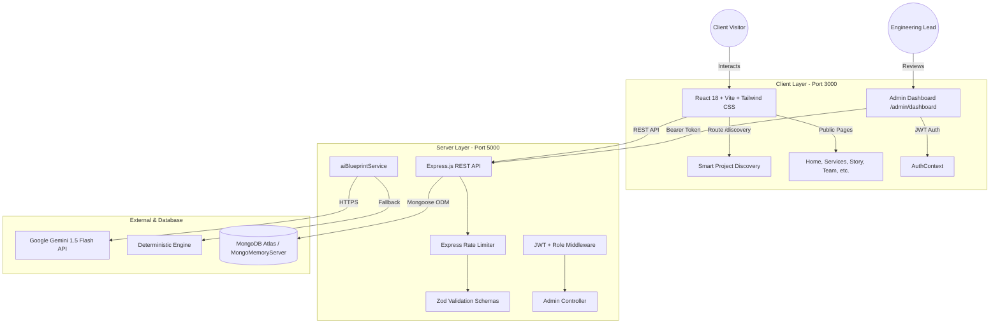

# Cynbit Technologies — High-Fidelity Website Recreation + Smart Project Hub

> **Technical Assessment for Full Stack Developer Intern**  
> An autonomous, high-fidelity recreation of the official [Cynbit Technologies](https://www.cynbit.in/) web platform, integrated with an innovative enterprise feature: **Cynbit Smart Project Hub (Discovery & AI Blueprint Engine)** and a protected **Admin Inquiry Command Center**.

---

## 📌 Executive Summary

This project delivers a complete, production-grade full-stack web application built inside this repository. It recreates the public-facing brand identity, visual architecture, and information hierarchy of **Cynbit Technologies** ([https://www.cynbit.in/](https://www.cynbit.in/)) while solving a critical user experience gap: **transforming ambiguous client project inquiries into structured, production-ready architectural blueprints using adaptive discovery and AI.**

### Disclaimer
> **Notice:** This project is an independent technical assessment prototype developed for recruitment evaluation. It is not affiliated with, operated by, or deployed to the production infrastructure of Cynbit Technologies.

---

## 🌟 Key Features

### 1. High-Fidelity Brand Recreation
- **Official Brand Design System**: Tailored colors reflecting Cynbit's palette:
  - Primary Deep Teal (`#006067`)
  - Accent Sky Blue (`#0284c7`)
  - Cyan Highlights (`#0d9488`)
  - Deep Onyx Dark Theme (`#0a0f14` & `#101820`)
- **Typography**: Google Fonts typography hierarchy using **Outfit** (headings) and **Inter** (technical body/UI).
- **Core Public Pages**:
  - ` / ` — **Homepage**: Cinematic hero with interactive architectural hub graphic, 6-stage delivery lifecycle, partner marquee, core product suites, testimonials, and FAQ.
  - `/services` — **Services Hub**: Enterprise suites (AI Automation, Full Stack Development, Cloud & DevOps) with interactive tech stack matrix.
  - `/story` — **Our Story**: Verified company timeline (2021: Preparatory Rigor → 2022: Validation → 2023: Roadmap → 2024: Official Launch) and architectural philosophy.
  - `/team` — **Leadership**: Profiles for founders **Mohak Saini** (Founder & CEO), **Ashutosh Upadhyay** (Co-Founder), and **Dhawan Nama** (Co-Founder & CTO).
  - `/products` — **Product Ecosystem**: Deep dives into **Cynbit Studio**, **TenantEase**, and **Revio** with interactive architecture modal.
  - `/bitelevate` — **Technical Learning**: Specialized cohort tracks for students, explicitly kept distinct from business client inquiry workflows.
  - `/careers` — **Careers & Internships**: Verified internship and full-time listings with dedicated application flow.
  - `/contact` — **Contact & Dispatch**: Jaipur HQ address (`32/115 Pratap Nagar, Jaipur, RJ 302033`), direct phone lines, email forms, and FAQ accordion.
- **Theme Switcher**: Working Dark / Light mode toggle with persistent state in `localStorage`.

---

### 2. Central Innovation: Cynbit Smart Project Hub (`/discovery`)
Solves the friction where non-technical or early-stage clients visit with vague ideas (e.g., *"I want to automate my business with AI"* or *"I need an app for customers"*):

- **Feature A — Smart Solution Finder**:
  - Interactive selection across 9 strategic project categories (Web Application, Mobile App, AI Process Automation, Autonomous Agents, Legacy Modernization, Cloud Infrastructure, Technical SEO, Cynbit Product Exploration, and General Guidance).
  - **Rule-Based Recommendation Engine**: Immediately maps the client's choice to Cynbit's primary delivery capability and recommended technology stack (transparently labeled as rule-based, not fake AI).
- **Feature B — Adaptive Project Discovery**:
  - Dynamic follow-up questionnaire tailored uniquely to the chosen category.
  - Step-by-step progress indicator, backward/forward navigation, input validation, and auto-save in `localStorage`.
  - Accessible "Need engineering guidance / Not sure" shortcuts.
- **Feature C — AI Project Blueprint**:
  - Backend integration with **Google Gemini 1.5 Flash API** (with a deterministic zero-failure fallback).
  - Generates a structured architectural blueprint:
    - *Project Overview*
    - *Problem Statement*
    - *Proposed Architecture Direction*
    - *Target Audience & Stakeholders*
    - *Core Functional Modules*
    - *Technical Stack & Deployment Considerations*
    - *Potential Integrations*
    - *Missing Information & Risks*
    - *Clarification Questions for Discovery Call*
    - *Suggested Next Steps aligned with Cynbit's 6-Stage Lifecycle*
  - Clear color-coded badges distinguishing: **Confirmed by Visitor** (Blue), **AI Recommendation** (Emerald), and **Clarification Required** (Amber).
  - **Inline Blueprint Editing**: Visitors can customize or refine any field before submitting.
  - Honest disclosure banner indicating whether live Gemini AI or the deterministic engine was used.
- **Feature D — Inquiry Submission & Reference Tracking**:
  - Collects client name, work email, company, phone, and explicit prototype submission consent.
  - Generates a unique tracking reference ID (format: `CYN-2026-XXXXXX`).
  - Persists inquiry and blueprint to MongoDB with status `"New"`.
  - Confirmation screen with copy-to-clipboard functionality.

---

### 3. Supporting Feature: Protected Admin Inquiry Dashboard (`/admin/dashboard`)
- **JWT & Bcrypt Security**: Strict route protection via Authorization Bearer header.
- **Dedicated Admin Login (`/admin/login`)**: Secure credential verification with JWT token issuance, protected against brute-force and credential exposure.
- **Operational Metrics**:
  - Total Inquiries
  - New Inquiries
  - Inquiries Reviewing
  - Clarification Required
  - Qualified Inquiries
  - Closed Inquiries
- **Interactive Inquiries Table**:
  - Live search across Client Name, Work Email, Company, and Reference ID.
  - Multi-status and category dropdown filters.
  - Color-coded status pills.
- **Slide-Over Blueprint Inspector**:
  - Displays original adaptive discovery answers.
  - Full AI Blueprint with modules and technical considerations.
  - **Live Status Updater**: Instantly switch status (New → Reviewing → Clarification Required → Qualified → Closed).
  - **Internal Notes Logger**: Add and timestamp internal engineering notes.

---

## 🏗️ Architecture & Technology Stack



| Layer | Technologies |
| :--- | :--- |
| **Frontend** | React 18, Vite 6, Tailwind CSS, React Router v6, Lucide React Icons |
| **Backend** | Node.js, Express.js (ES Modules), CORS, Morgan |
| **Database** | MongoDB Atlas with Mongoose ODM (Auto-fallback to `mongodb-memory-server` for zero-setup local runs) |
| **Security** | JWT (jsonwebtoken), Bcrypt.js password hashing, Zod request schema validation, Rate Limiting |
| **AI Integration** | Google Gemini 1.5 Flash API with domain-tailored deterministic fallback |
| **DevOps** | Vercel (Client deployment ready), Render / Railway (Server deployment ready) |

---

## 🚀 Quick Start Guide (Local Setup)

The application has been engineered to run out of the box with zero external setup required. If MongoDB is not installed locally or no Atlas URI is provided, the backend automatically boots an in-memory MongoDB server and seeds initial demo inquiries and the admin user!

### Prerequisites
- **Node.js**: v18.0.0 or higher
- **npm**: v9.0.0 or higher
- **Git**

---

### Step 1: Clone & Inspect Repository
```bash
git clone <repository-url>
cd Cynbit
```

---

### Step 2: Backend Setup
Open a terminal in the `server` directory:
```bash
cd server
npm install
```

Create a `.env` file from the provided example:
```bash
cp .env.example .env
```
*(The default `.env` will use the in-memory database and deterministic fallback if no external keys are added).*

Start the backend server:
```bash
npm run dev
# Or for standard execution:
node server.js
```
The server will start on **`http://localhost:5000`** and log:
```
ℹ️ Notice: No MONGODB_URI provided. Starting MongoMemoryServer for development...
✅ Connected to MongoMemoryServer successfully (in-memory mode for development).
ℹ️ Database Mode: In-Memory (MongoMemoryServer). Data resets on process termination.
ℹ️ Admin user seeded: admin@cynbit.in
ℹ️ Seeded 3 initial synthetic demo inquiries for testing.
🚀 Cynbit Server running on port 5000
```

---

### Step 3: Frontend Setup
In a new terminal window, navigate to the `client` directory:
```bash
cd client
npm install
npm run dev
```
Open **`http://localhost:3000`** in your browser.

---

## 🔐 Admin Authentication Setup

The **Admin Inquiry Dashboard** (`/admin/dashboard`) is strictly protected and requires a valid JWT Bearer token obtained via `/api/admin/login`.

To provision an administrative account securely:

1. **Option A: Via Environment Variables (Recommended for local dev)**  
   Specify credentials in `server/.env`:
   ```bash
   ADMIN_EMAIL=your-admin@cynbit.in
   ADMIN_PASSWORD=YourStrongPasswordHere
   ```
   When the server boots, it checks if an admin exists and provisions it with `bcrypt` (10 rounds).

2. **Option B: Safe CLI Seeding Script**  
   From the `server` directory, run:
   ```bash
   node scripts/seedAdmin.js
   ```
   If no `ADMIN_PASSWORD` is defined in `.env`, the script automatically generates a cryptographically secure random one-time password and prints it securely to stdout.

*Security Notice: Passwords are encrypted with bcrypt, never committed to git, excluded from JSON serialization via Mongoose `toJSON` transforms, and never returned in API payloads.*

---

## 🗄️ Database Architecture & Persistence Transparency

- **Development In-Memory Mode (`mongodb-memory-server`)**: If no `MONGODB_URI` is provided, the server initializes an embedded in-memory MongoDB instance so reviewers can test the application immediately with zero setup. **Note that in-memory storage resets when the server process stops.** In-memory mode is never represented as production persistence.
- **Production Persistence Mode (MongoDB Atlas / External MongoDB)**: Set `MONGODB_URI=mongodb+srv://<user>:<password>@cluster.mongodb.net/cynbit` in `server/.env`. In production (`NODE_ENV=production`), the server enforces a real database connection and rejects startup if `MONGODB_URI` is missing.
- **Health Diagnostics (`GET /api/health`)**: Transparently reports whether the active database is an in-memory session or a production-persistent cluster.

---

## 📡 API Reference Documentation

### Public Endpoints

#### `GET /api/health`
Health check verifying server status, environment, and detailed database connectivity.
- **Response 200**:
  ```json
  {
    "success": true,
    "status": "healthy",
    "timestamp": "2026-10-31T05:55:00.000Z",
    "database": {
      "status": "Connected",
      "type": "MongoMemoryServer (In-Memory Development)",
      "isProductionPersistent": false,
      "isFallbackMode": true,
      "notice": "In-memory database is active for zero-config local evaluation. Data will reset on server restart. For persistent production storage, set MONGODB_URI in server/.env."
    },
    "environment": "development"
  }
  ```

#### `POST /api/discovery/blueprint`
Analyzes discovery answers and generates an architectural project blueprint.
- **Body**:
  ```json
  {
    "category": "ai-automation",
    "answers": {
      "businessProcess": "Invoice verification and matching",
      "currentSystem": "Manual entry in Excel",
      "toolsInUse": "Gmail, SAP, Google Drive",
      "goals": "Reduce turnaround time to 10 minutes"
    }
  }
  ```
- **Response 200**: Returns structured blueprint with overview, problem, solution, functional requirements, technical considerations, clarification questions, and next steps.

#### `POST /api/inquiries`
Validates and persists a client project inquiry and blueprint.
- **Body**:
  ```json
  {
    "clientName": "Dr. Siddharth Sen",
    "email": "siddharth@medixcare.com",
    "company": "MedixCare Health",
    "phone": "+91 99887 76655",
    "projectCategory": "Build a new website or web application",
    "discoveryAnswers": { ... },
    "generatedBlueprint": { ... },
    "consentGiven": true
  }
  ```
- **Response 201**: Returns unique reference ID (`CYN-2026-XXXXXX`) and inquiry record.

---

### Protected Admin Endpoints *(Requires `Authorization: Bearer <token>`)*

| Method | Endpoint | Description |
| :--- | :--- | :--- |
| `POST` | `/api/admin/login` | Authenticates admin credentials, returns JWT. |
| `GET` | `/api/admin/me` | Returns current admin profile. |
| `GET` | `/api/admin/stats` | Returns aggregate counts by status (New, Reviewing, etc.). |
| `GET` | `/api/admin/inquiries` | Returns paginated inquiries list with search and filter support. |
| `GET` | `/api/admin/inquiries/:id` | Returns full inquiry with adaptive answers and AI blueprint. |
| `PATCH` | `/api/admin/inquiries/:id/status` | Updates inquiry status (`New`, `Reviewing`, `Clarification Required`, `Qualified`, `Closed`). |
| `PATCH` | `/api/admin/inquiries/:id/notes` | Appends an internal timestamped note with author attribution. |

---

## ☁️ Deployment Guide

### Frontend Deployment (Vercel)
1. Push the code to your GitHub repository.
2. In Vercel, click **New Project** and select the repository.
3. Set **Root Directory** to `client`.
4. Framework Preset: **Vite**.
5. Build Command: `npm run build` (outputs to `dist`).
6. A configured `client/vercel.json` is included with SPA rewrites (`"source": "/(.*)", "destination": "/index.html"`) to ensure deep routing works cleanly.
7. Set Environment Variable:
   - `VITE_API_URL`: Your deployed backend URL (e.g., `https://cynbit-api.onrender.com`).
8. Deploy!

### Backend Deployment (Render / Railway)
1. A ready-to-use Render Blueprint is provided in `server/render.yaml`.
2. Alternatively, in Render, create a new **Web Service** pointing to the repository.
3. Set **Root Directory** to `server`.
4. Build Command: `npm install`
5. Start Command: `node server.js`
6. Configure Environment Variables in Render:
   - `PORT`: `5000`
   - `NODE_ENV`: `production`
   - `MONGODB_URI`: Your MongoDB Atlas connection string (`mongodb+srv://...`)
   - `JWT_SECRET`: A strong random 32+ character string
   - `GEMINI_API_KEY`: *(Optional)* Your Google Gemini API key
   - `CORS_ORIGIN`: Your Vercel frontend URL
7. Deploy!

---

## 🛡️ Security & Privacy Practices

- **Zero Hardcoded Secrets**: All API keys, database URIs, and JWT secrets are managed strictly through environment variables.
- **Git Hygiene**: Strict `.gitignore` prevents `node_modules`, `.env`, and build artifacts from ever being committed.
- **Input Sanitization & Validation**: Robust Zod schemas validate both incoming discovery data and inquiry contact submissions.
- **Password Hashing**: Admin credentials stored in database are hashed with `bcryptjs` using a salt work factor of 10.
- **Prototype Transparency**: Clear disclaimers on every page ensure visitors and stakeholders recognize this application as an independent assessment prototype.

---

## 📄 License & Attribution

- Built as an independent Full Stack Developer Intern technical assessment.
- Original brand identity, company history, and service names belong to **Cynbit Technologies** ([https://www.cynbit.in/](https://www.cynbit.in/)).
- Developed with architectural rigor and care.
