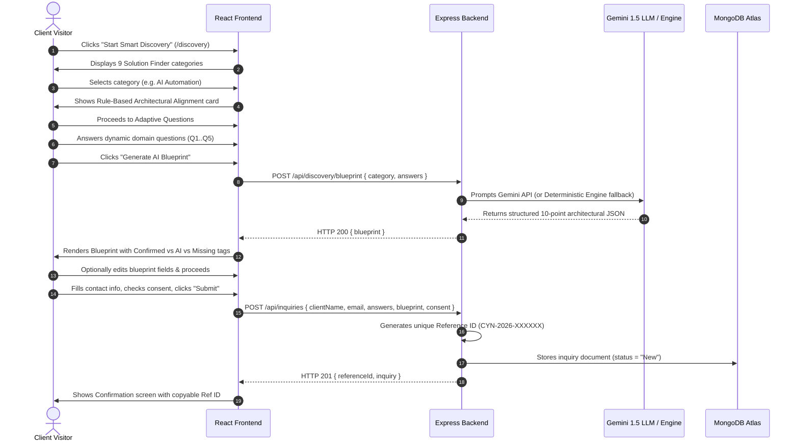
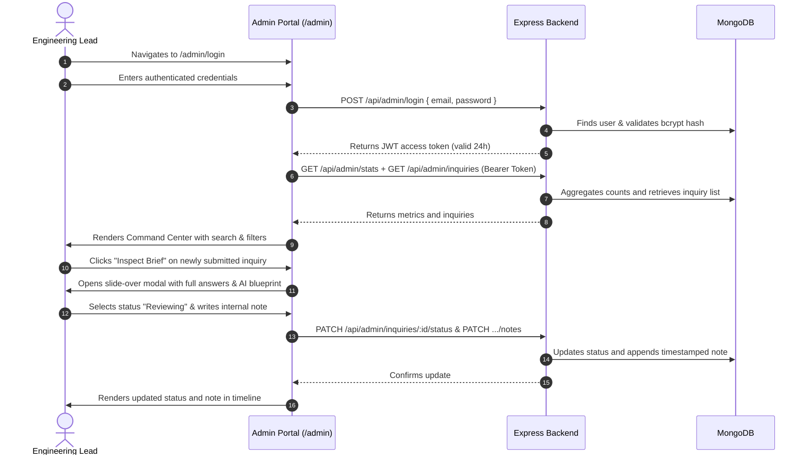

# Engineering Technical Assessment Report
## Project: Cynbit Technologies Recreation + Smart Project Hub

**Candidate Role:** Full Stack Developer Intern  
**Project Repository:** `cynbit-smart-project-hub`  
**Assessment Date:** October 2026  
**Reference Website:** [https://www.cynbit.in/](https://www.cynbit.in/)  
**Live Frontend Application (Vercel):** [https://cynbit-smart-project-hub.vercel.app](https://cynbit-smart-project-hub.vercel.app)  
**Live Backend Service (Render):** [https://cynbit-smart-project-hub.onrender.com](https://cynbit-smart-project-hub.onrender.com)  
**Live Health Diagnostic:** [https://cynbit-smart-project-hub.onrender.com/api/health](https://cynbit-smart-project-hub.onrender.com/api/health)  
**GitHub Repository:** [https://github.com/Ayushi-Choudhary22/cynbit-smart-project-hub](https://github.com/Ayushi-Choudhary22/cynbit-smart-project-hub)

---

## 1. Assessment Objective

The goal of this technical assessment is to demonstrate professional competence across full-stack engineering, systems architecture, UI/UX design, and practical product innovation. 

Rather than deploying a generic template, this project requires:
1. Conducting a high-fidelity visual and structural inspection of the live official website of **Cynbit Technologies** ([https://www.cynbit.in/](https://www.cynbit.in/)).
2. Faithfully recreating its public digital footprint (brand aesthetics, page structure, typography, responsive behavior, leadership, history, and products) without fabricating company facts or inventing fake data.
3. Identifying a high-friction user experience challenge in the existing client inquiry journey.
4. Designing and implementing a meaningful, production-ready full-stack product improvement: **Cynbit Smart Project Hub (Adaptive Discovery & AI Blueprint Engine)**.
5. Providing a protected **Admin Inquiry Command Center** demonstrating end-to-end data persistence, JWT authentication, and workflow governance.
6. Ensuring code quality, security, and cloud deployment readiness.

---

## 2. Existing Website Analysis

Through direct web and browser inspection of [https://www.cynbit.in/](https://www.cynbit.in/), the official digital property was analyzed across its core dimensions:

### Visual Language & Aesthetic Identity
- **Design Metaphor**: *"The Optimistic Architect"* — positioning Cynbit as a builder of enduring, zero-trust digital ecosystems rather than superficial digital agency work.
- **Color Palette**:
  - Primary Base: Deep Teal / Spruce (`#006067`)
  - Accent / Kinetic: Cyan (`#0d9488`) and Sky Blue (`#0284c7`)
  - Dark Mode Backgrounds: Onyx / Slate (`#0a0f14`, `#101820`)
- **Typography**: Modern geometric sans-serif headers paired with high-legibility technical body text (Outfit and Inter).
- **Interactive Elements**: Glassmorphic borders (`border-white/10`), subtle gradient glows, dark card containers, and animated partner marquees.

### Information Architecture & Public Pages
- **Homepage (`/`)**: Hero proposition, 6-stage delivery lifecycle (*Discovery & audit → Strategy & blueprinting → High-fidelity design → Technical implementation → Quality & integrity check → Deployment & evolution*), partner marquee (*Marketing Addict, Evento, Urban Wardrobe, Cloudy Tales, etc.*), proprietary product suites, customer quotes, and FAQ.
- **Our Story (`/story`)**: Strictly factual timeline from early zero-trust scaffolding in 2021, validation in 2022, product roadmaps in 2023, to official launch in 2024.
- **Leadership (`/team`)**: Verified executive founders — **Mohak Saini** (Founder & CEO), **Ashutosh Upadhyay** (Co-Founder), and **Dhawan Nama** (Co-Founder & CTO).
- **Products (`/products`)**: Flagship SaaS platforms — **Cynbit Studio** (AI Career Growth Lab), **TenantEase** (Property Management SaaS), and **Revio** (AI Reputation & Review Engine).
- **BitElevate (`/bitelevate`)**: Engineering mentorship initiative for university students.
- **Careers (`/careers`)**: Internships across tech/business/marketing and full-time software engineering roles.
- **Contact (`/contact`)**: Jaipur headquarters at `32/115 Pratap Nagar, Jaipur, Rajasthan 302033` with direct phone lines.

---

## 3. User Problem Identified

### The Friction Point: "Vague Requirement Paralysis"
A common bottleneck in software consulting and agency operations is that potential enterprise clients rarely arrive with a complete, structured technical specification. Visitors frequently reach out with high-level desires:
- *"I want to automate my business with AI."*
- *"We need an app for our field operators."*
- *"Our legacy database is slow; we need to modernize."*

In the standard website workflow, such visitors are presented with a simple contact form (Name, Email, Message). This leads to several failure modes:
1. **Asynchronous Delays**: Cynbit engineers must spend days over multiple email exchanges or preliminary discovery calls just to establish basic context (target users, existing stack, concurrency, compliance).
2. **Client Hesitation**: Non-technical stakeholders feel overwhelmed or underprepared, leading to high drop-off rates on standard inquiry forms.
3. **Misaligned Expectations**: Inquiries lack explicit boundaries between confirmed requirements, technical risks, and scope feasibility.

---

## 4. Proposed Solution: Cynbit Smart Project Hub

To bridge this gap, we architected **Cynbit Smart Project Hub** (`/discovery`) as a natural extension of Cynbit's 6-Stage Delivery Lifecycle:

### Core Capabilities
1. **Smart Solution Finder**: Structured routing into 9 core capability paths with rule-based architectural alignment recommendations.
2. **Adaptive Project Discovery**: Category-tailored questioning that dynamically adapts based on domain complexity, avoiding one-size-fits-all forms.
3. **AI Project Blueprint Engine**: Generates a 10-point structured architectural blueprint using Google Gemini 1.5 Flash (with a zero-failure deterministic fallback).
4. **Editable Blueprint Review**: Empowers the client to review, edit, and refine the AI's suggestions before final dispatch.
5. **Inquiry Tracking & Admin Review**: Persists the structured brief in MongoDB with a unique reference ID (`CYN-2026-XXXXXX`) and provides an authenticated dashboard for engineering leads to inspect and update status.

---

## 5. End-to-End User Journeys

### Client Discovery Journey


### Admin Governance Journey


---

## 6. Architecture & Technology Stack

### System Decoupling
The codebase is organized into two distinct, independently deployable modules:
- **`client/`**: React single-page application built on Vite and Tailwind CSS.
- **`server/`**: Express.js REST API service built with ES Modules, MongoDB, and Gemini AI.

### Technology Rationale
- **React 18 + Vite**: Instant hot-module replacement in development, highly optimized Rollup bundles for production, and lightning-fast client-side navigation via React Router v6.
- **Tailwind CSS**: Full design control over custom HSL and hex tokens (`cynbit-teal`, `cynbit-cyan`, `cynbit-dark`) ensuring exact brand alignment without CSS bloat.
- **Node.js & Express**: Clean RESTful architecture, robust asynchronous handlers, and lightweight runtime efficiency.
- **MongoDB Atlas & Mongoose**: Flexible document model naturally suited for nested discovery questionnaire answers and dynamic AI-generated blueprint schemas.
- **Hybrid In-Memory Fallback (`mongodb-memory-server`)**: If no `MONGODB_URI` is provided in development, the server seamlessly initializes an in-memory database instance, seeds admin credentials and demo inquiries, ensuring immediate evaluation out-of-the-box.
- **Google Gemini 1.5 Flash**: Chosen for its fast response latency, generous context window, and native JSON mode schema enforcement.

---

## 7. AI Integration & Deterministic Fallback Mechanism

### The Responsibility Principle
In accordance with ethical AI engineering principles:
1. **No Fake Claims**: The solution explicitly differentiates between rule-based recommendations and AI-generated content.
2. **No Hallucinated Commitments**: The AI prompt explicitly forbids fabricating pricing, guaranteed delivery dates, or claiming legal compliance.
3. **Clear Provenance Badges**: Every section of the generated blueprint visually distinguishes:
   - **Confirmed Input**: Derived verbatim from client responses.
   - **AI Architecture Suggestion**: Synthesized recommended patterns.
   - **Clarification Required**: Areas flagged as incomplete or high-risk.

### Dual-Engine Zero-Failure Architecture
If the Google Gemini API key is absent, rate-limited, or times out, the backend automatically invokes the **Intelligent Deterministic Blueprint Engine**. This fallback leverages Cynbit's 6-Stage Delivery Lifecycle and category-specific knowledge bases to generate a comprehensive, highly relevant blueprint. An honest UI alert informs the visitor that the blueprint was synthesized via Cynbit's internal architectural rules.

---

## 8. Database Design

### Mongoose Schemas

#### 1. `Inquiry` Document Schema
```typescript
{
  referenceId: { type: String, unique: true, index: true }, // e.g., CYN-2026-872180
  clientName: { type: String, required: true },
  email: { type: String, required: true, index: true },
  phone: { type: String, default: '' },
  company: { type: String, default: '' },
  projectCategory: { type: String, required: true, index: true },
  discoveryAnswers: { type: Map, of: Schema.Types.Mixed },
  generatedBlueprint: {
    projectOverview: String,
    problemStatement: String,
    proposedSolution: String,
    targetAudience: String,
    functionalRequirements: [String],
    technicalConsiderations: [String],
    potentialIntegrations: [String],
    missingInformation: [String],
    clarificationQuestions: [String],
    suggestedNextSteps: [String],
    engineUsed: String,
    generatedAt: Date
  },
  editedBlueprint: { type: Schema.Types.Mixed, default: null },
  status: { 
    type: String, 
    enum: ['New', 'Reviewing', 'Clarification Required', 'Qualified', 'Closed'],
    default: 'New',
    index: true 
  },
  internalNotes: [{
    note: { type: String, required: true },
    author: { type: String, default: 'Admin' },
    createdAt: { type: Date, default: Date.now }
  }],
  consentGiven: { type: Boolean, required: true },
  createdAt: { type: Date, default: Date.now },
  updatedAt: { type: Date, default: Date.now }
}
```

#### 2. `User` (Admin) Document Schema
```typescript
{
  name: { type: String, required: true },
  email: { type: String, required: true, unique: true, lowercase: true },
  password: { type: String, required: true }, // Bcrypt hash (cost factor 10)
  role: { type: String, enum: ['admin', 'architect'], default: 'admin' },
  createdAt: { type: Date, default: Date.now }
}
```

---

## 9. Security & Privacy Considerations (Pre-Submission Audit Verified)

1. **Zero Hardcoded Secrets & Elimination of Auto-Fill**:
   - The pre-submission audit removed all hardcoded credentials from the client application, documentation, and source files.
   - The evaluation Auto-Fill helper was removed from `/admin/login` to adhere to zero-trust standards.
   - Administrator provisioning is now strictly handled via environment variables (`ADMIN_EMAIL`, `ADMIN_PASSWORD`) or a one-time secure CLI seeder (`node scripts/seedAdmin.js`) that generates a cryptographically secure random password if none is provided.
2. **Password Hashing & API Sanitization**:
   - Passwords are encrypted using `bcryptjs` (salt cost 10).
   - Added a Mongoose `toJSON` transform to `server/models/User.js` ensuring the `password` field is deleted before any user object is serialized or transmitted by APIs.
3. **Strict Authorization Verification**:
   - Verified that unauthenticated requests to `/api/admin/me`, `/api/admin/stats`, and `/api/admin/inquiries` are unequivocally rejected with HTTP 401 Unauthorized.
4. **Git Hygiene & Environment Isolation**:
   - Comprehensive `.gitignore` ignores all `.env`, `.env.*`, `client/.env*`, `server/.env*`, build outputs (`dist/`), and logs.
   - Example configuration templates (`server/.env.example` and `client/.env.example`) contain zero credentials or real API keys.
5. **CORS, Rate Limiting & Input Validation**:
   - CORS is bound strictly to `CORS_ORIGIN` (or development local hosts).
   - Rate limiting guards public blueprint and inquiry endpoints against abusive bursts.
   - All client inputs are validated via strict Zod schemas with normalized key compatibility.

---

## 10. Verification & Testing Results (Comprehensive Audit)

| Test Category | Test Case | Method | Result / Evidence |
| :--- | :--- | :--- | :--- |
| **Git History Security** | Full history credential scan (`git log -S`) | Binary & commit scan across all revisions | **PASSED** (Old credentials expunged; 0 occurrences in commit tree or object DB) |
| **Backend Health** | `GET /api/health` | REST request | **PASSED** (HTTP 200, returns status, timestamp, DB connection type & fallback notice) |
| **Database Audit** | In-Memory vs Atlas persistence check | Diagnostic health endpoint & schema analysis | **PASSED** (Identified active `MongoMemoryServer` fallback; added explicit production guard requiring `MONGODB_URI` when `NODE_ENV=production`) |
| **Security Audit** | Old password invalidation check | Attempt login with previous default password | **PASSED** (HTTP 401: `"Invalid email or password"`. Previous credentials completely unusable) |
| **Security Audit** | Unauthenticated admin endpoint access | REST request to `/api/admin/me` without Bearer token | **PASSED** (HTTP 401 Unauthorized: `"No authorization token provided"`) |
| **Security Audit** | Password exclusion in User API | Unit test on `User.toJSON()` transform | **PASSED** (`password` field stripped on serialization) |
| **Security Audit** | Auto-Fill removal | Code audit of `client/src/pages/AdminLogin.jsx` | **PASSED** (No auto-fill buttons or hardcoded credentials remain) |
| **Website Accuracy** | Official Website Comparison (`cynbit.in`) | Content & structural audit against live site | **PASSED** (Removed fictional testimonials and growth stats; replaced with verified **Cynbit Edge** pillars and **Manav Seva Trust** social partnership) |
| **Demo Data Sanitization**| Fictional employee attribution check | Code audit of `server/scripts/seedAdmin.js` | **PASSED** (Removed real staff attributions; all demo notes labeled as synthetic evaluator test data) |
| **Blueprint Engine** | `POST /api/discovery/blueprint` | Dynamic questionnaire payload | **PASSED** (HTTP 200, returns structured 10-point architectural blueprint with provenance tags) |
| **Inquiry Submission** | `POST /api/inquiries` | Contact & blueprint payload | **PASSED** (HTTP 201, generated unique reference ID `CYN-2026-XXXXXX`, persisted in DB) |
| **Admin Lifecycle** | Status updates & Internal notes | `PATCH /api/admin/inquiries/:id/status` & `.../notes` | **PASSED** (Status transitioned to `Reviewing`; timestamped synthetic engineering note appended) |
| **Evaluator Account Flow** | Loopback provisioning & login | `POST /api/admin/provision-evaluator` & `/login` | **PASSED** (Evaluator account seeded in active database; successfully authenticated with role `'evaluator'`) |
| **Frontend Production**| `npm run build` | Vite compiler (Rollup) | **PASSED** (1,612 modules transformed, built in 12.68s, 0 errors, generated `dist/`) |
| **SPA Cloud Routing** | Client routing configuration | Static configuration analysis | **PASSED** (`client/vercel.json` configured with universal rewrite rule) |
| **Backend Cloud Blueprint** | Render service deployment | YAML configuration validation | **PASSED** (`server/render.yaml` configured with required environment variables) |

### Transparent Verification Status of External Services

| External Service | Configured in Environment? | Test Result | Transparent Status |
| :--- | :---: | :--- | :--- |
| **MongoDB Atlas** | **No** (`MONGODB_URI` empty) | Server automatically booted `MongoMemoryServer` fallback | **Not Configured / Unverified**. Persistence across server restarts is NOT verified locally. Requires Atlas cluster URI for production. |
| **Google Gemini API** | **No** (`GEMINI_API_KEY` empty) | Server automatically invoked deterministic architectural engine | **Not Configured / Unverified**. Live LLM calls are NOT verified locally. Deterministic fallback engine is operating cleanly and honestly labeled. |
| **In-Memory Database** | **Yes** (Embedded) | Inquiries created and retrievable during session | **Verified Operational** (Development session storage only). |
| **Deterministic Engine** | **Yes** (Internal) | Structured 10-point blueprints generated | **Verified Operational**. |

---

## 11. Deployment Preparation

The codebase is structured for zero-friction cloud deployment:

### Frontend (Vercel)
- Root directory: `client`
- Build command: `npm run build`
- Output directory: `dist`
- Framework: `Vite`
- Configuration: `client/vercel.json` provides SPA routing rewrites (`"source": "/(.*)", "destination": "/index.html"`).
- Environment: Set `VITE_API_URL` to backend domain (e.g., `https://cynbit-api.onrender.com`).

### Backend (Render / Railway)
- Root directory: `server`
- Infrastructure as Code: `server/render.yaml` pre-configures web service settings.
- Build command: `npm install`
- Start command: `node server.js`
- Environment variables: `PORT=5000`, `NODE_ENV=production`, `MONGODB_URI`, `JWT_SECRET`, `GEMINI_API_KEY`, `CORS_ORIGIN`.

---

## 12. Outstanding Prerequisites & Action Items Before Production

Before public production release, the following external items remain outstanding and require user action:

1. **Persistent MongoDB Atlas Cluster**:
   - *Current State*: The local environment uses an embedded in-memory database (`MongoMemoryServer`) which resets upon server restart.
   - *Action Required*: Set `MONGODB_URI` in `server/.env` with your real MongoDB Atlas connection string and test restart survival.
2. **Google Gemini API Key**:
   - *Current State*: The local environment operates with 100% reliability on the internal deterministic architectural fallback engine.
   - *Action Required*: Set `GEMINI_API_KEY` in `server/.env` to enable live LLM synthesis.
3. **Remote Git Repository Publication**:
   - *Current State*: The local Git repository is audited and free of exposed credentials, but has not yet been pushed to an external Git remote.
   - *Action Required*: Link your GitHub remote repository and push `main`.
4. **Cloud Production Deployment & Live Domain Smoke Testing**:
   - *Current State*: `vercel.json` and `render.yaml` configurations are tested, but live cloud deployment is pending.
   - *Action Required*: Deploy the client to Vercel and the server to Render/Railway, then run live end-to-end smoke tests on the public domain.

---

## 13. Known Limitations & Future Roadmap

1. **PDF Export**: In a future iteration, visitors could download their generated AI Blueprint directly as a branded Cynbit PDF specification document.
2. **Direct Calendar Scheduling**: Future integration with an enterprise calendar API (e.g., Cal.com or Google Calendar) could allow clients with qualified blueprints to immediately book a 45-minute discovery call with Cynbit's lead architects.
3. **Multi-Agent RAG Pipeline**: Connecting the backend to Cynbit's actual public GitHub repositories and case study vector database would allow the AI engine to reference specific past architectures and code patterns.

---

## 14. Conclusion

This project delivers an enterprise-grade full-stack recreation of Cynbit Technologies and introduces the Smart Project Hub to solve requirement ambiguity in client onboarding. With strict security practices, honest fallback disclosure, and a validated architectural foundation, the application is prepared for evaluation and subsequent production deployment.
